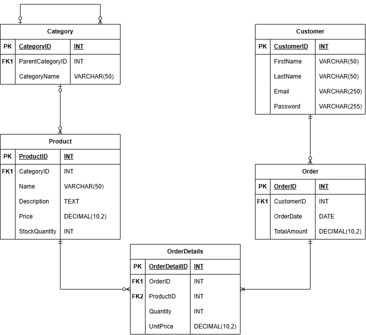

## ERD



## Schema

```sql
CREATE DATABASE ECOMMERCE;
USE ECOMMERCE;

CREATE TABLE Customer (
	CustomerID AUTO_INCREMENT INT,
    FirstName VARCHAR(50) NOT NULL,
    LastName VARCHAR(50) NOT NULL,
    Email VARCHAR(250) NOT NULL,
    CustomerPassword VARCHAR(255) NOT NULL,
    
    PRIMARY KEY (CustomerID)
);

CREATE TABLE Category (
    CategoryID AUTO_INCREMENT INT,
    CategoryName VARCHAR(50),
    ParentCategoryID INT,
    
    PRIMARY KEY (CategoryID),
    FOREIGN KEY (ParentCategoryID) REFERENCES Category(CategoryID)
);

CREATE TABLE Product (
    ProductID AUTO_INCREMENT INT,
    CategoryID INT,
    ProductName VARCHAR(50),
    ProductDescription TEXT,
    Price DECIMAL(10,2) CHECK (Price >= 0),
    StockQuantity INT,
    
    PRIMARY KEY (ProductID),
    FOREIGN KEY (CategoryID) REFERENCES Category(CategoryID)
);

CREATE TABLE Orders (
    OrderID AUTO_INCREMENT INT,
    CustomerID INT,
    OrderDate DATE,
    TotalAmount DECIMAL(10,2) CHECK (TotalAmount >= 0),
    
    PRIMARY KEY (OrderID),
    FOREIGN KEY (CustomerID) REFERENCES Customer(CustomerID)
);

CREATE TABLE OrderDetails (
    OrderDetailID AUTO_INCREMENT INT,
    OrderID INT,
    ProductID INT,
    Quantity INT,
    UnitPrice DECIMAL(10,2)  CHECK (UnitPrice >= 0),
    
    PRIMARY KEY (OrderDetailID),
    FOREIGN KEY (OrderID) REFERENCES Orders(OrderID),
    FOREIGN KEY (ProductID) REFERENCES Product(ProductID)
);
```

## Reports

-  Write an SQL query to generate a daily report of the total revenue for a specific date.

```sql
SELECT OrderDate AS RevenueDate, SUM(TotalAmount) AS TotalRevenue
FROM Orders
GROUP BY OrderDate;
```

- Write an SQL query to generate a monthly report of the top-selling products in a given month.

```sql
SELECT p.ProductName, SUM(od.UnitPrice) AS TotalAmount
FROM Orders o JOIN OrderDetails od ON o.OrderID = od.OrderID
    JOIN Product p ON p.ProductID = od.ProductID
WHERE o.OrderDate BETWEEN '2023-08-01' AND '2023-08-31'
GROUP BY p.ProductName
ORDER BY TotalAmount DESC;
```

-  Write a SQL query to retrieve a list of customers who have placed orders totaling more than $500 in the past month. Include customer names and their total order amounts.

```sql
SELECT c.CustomerID, c.FirstName, c.LastName, SUM(o.TotalAmount) AS TotalOrders
FROM Customer c JOIN Orders o ON c.CustomerID = o.CustomerID
WHERE o.OrderDate BETWEEN '2023-12-01' AND '2023-12-31'
GROUP BY c.CustomerID, c.FirstName, c.LastName
HAVING TotalOrders >= 500
ORDER BY TotalOrders DESC;
```

## Denormalization

Applying a denormalization mechanism on customer and order entities begins with identifying repeated queries that could potentially harm the database performance.

Such harmful queries to consider would be the generation of customers' total spending. To solve this problem it would be a good idea to add a total spending column to the customer table and add each new order total to that column. Of course that would take some time on the insertion of new orders, but the administrator would have to weigh the tradeoff between having this behavior added and whether it's actually worth the added load.
